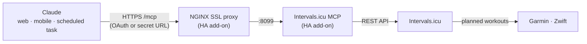

<!-- mcp-name: io.github.hhopke/intervals-icu-mcp -->

# Intervals.icu MCP — remote coach edition

A remote [Model Context Protocol](https://modelcontextprotocol.io) server for
[Intervals.icu](https://intervals.icu), built to back a **personal AI training coach in Claude**.
Claude reads your activities, wellness (HRV, sleep, resting HR), fitness and form, then writes
planned workouts to your Intervals.icu calendar. Intervals.icu syncs those workouts on to your
watch and trainer apps (for example Garmin and Zwift).

It runs as a **Home Assistant add-on** behind the NGINX SSL proxy add-on, and you connect it to
Claude as a **custom connector**. That makes it available on claude.ai web, the mobile apps and
scheduled tasks. The connector is protected either by an Intervals.icu **OAuth** login or by a
**secret URL**.

> This is a fork of [hhopke/intervals-icu-mcp](https://github.com/hhopke/intervals-icu-mcp)
> (MIT), which itself started from [eddmann/intervals-icu-mcp](https://github.com/eddmann/intervals-icu-mcp).
> The fork adds per-request OAuth auth, a secret-path mode, coach-oriented calendar features and the Home Assistant add-on. See [Credits](#credits--upstream).

[](https://github.com/bjorngadde/intervals-icu-mcp/actions/workflows/test.yml)
[](https://github.com/bjorngadde/intervals-icu-mcp/actions/workflows/ha-addon.yml)
[](LICENSE)

## How it fits together



- **Read:** activities, streams and intervals; wellness (HRV, sleep, resting HR); fitness and
  form (CTL / ATL / TSB); the calendar; zones and thresholds.
- **Write:** structured workouts on the calendar, with the indoor flag, tags and an
  `external_id` that marks the events the coach created. Re-planning updates those events
  instead of duplicating them.
- **Check:** whether each workout parsed into steps, and whether Intervals.icu managed to push
  it to Garmin or Zwift (`push_errors`).

## Setup (Home Assistant)

You need Home Assistant with the **NGINX Home Assistant SSL proxy** add-on, a host name with a
valid certificate (for example `intervals.example.com`), and an Intervals.icu account.

1. **Install the add-on.** In Home Assistant, go to **Settings → Add-ons → Add-on Store → ⋮ →
   Repositories**, add `https://github.com/bjorngadde/intervals-icu-mcp`, then install
   **Intervals.icu MCP**.
2. **Choose how Claude authenticates** and fill in the add-on options. The add-on refuses to
   start until at least one mode is configured.

   | Mode | When | Options | Claude connector URL |
   |---|---|---|---|
   | **Secret URL** | works right away | `api_key`, `athlete_id`, `path_secret` (≥ 32 random characters) | `https://<host>/<path_secret>/mcp` |
   | **OAuth** | once your Intervals.icu OAuth app is approved | `oauth_client_id`, `oauth_client_secret`, `public_base_url`, `allowed_athlete_ids` | `https://<host>/mcp` |

   Both modes can be on at the same time. Generate secrets with
   `python3 -c 'import secrets; print(secrets.token_urlsafe(32))'`. For OAuth, register
   `https://<host>/auth/callback` as the app's redirect URI in Intervals.icu → Settings → Apps.
3. **Route it through NGINX.** Copy [`ha-addon/nginx/intervals.conf`](ha-addon/nginx/intervals.conf)
   to `/share/nginx_proxy/`, replace the host name, enable `customize` in the NGINX add-on and
   restart it. **Do not forward port 8099**; only NGINX (443) should be reachable.
4. **Add the connector in Claude:** **Settings → Connectors → Add custom connector**, using the URL
   from the table. With OAuth, Claude opens a consent page and then the Intervals.icu login.
5. **Check it:** `https://<host>/healthz` returns `{"status":"ok"}`. Then ask Claude *"Show me my
   activities from the last 7 days."*

Full option reference, OAuth details and troubleshooting: [`ha-addon/DOCS.md`](ha-addon/DOCS.md)
and [`docs/oauth.md`](docs/oauth.md).

## The daily coach

Create a daily **scheduled task** in Claude with the Intervals.icu connector enabled, and give it
a prompt like this:

```text
Run my daily Intervals.icu coach check and plan the next 2 days.
Check my readiness (wellness for the last 7 days and fitness summary), the last 7
days of training, and the calendar.
Only change events whose external_id starts with "ai-coach-". Write each workout
with indoor set correctly, tags ["ai-coach"], external_id "ai-coach-YYYY-MM-DD-<slug>"
and Intervals.icu workout syntax in the description. Then check that the workouts
parsed and report any push_errors.
```

The server also ships this routine as the MCP prompt **`daily_coach_check`** (arguments
`days_ahead` and `coach_tag`), which you can pick from the prompt menu in a chat.

Conventions the coach relies on:

| Feature | How |
|---|---|
| Mark coach-created events | `tags=["ai-coach"]` plus `external_id="ai-coach-…"`; find them with `icu_get_calendar_events(external_id_prefix="ai-coach-")` |
| Re-plan without duplicates | `icu_bulk_create_events(..., upsert_by_external_id=true)` (OAuth connections) |
| Indoor or outdoor | `indoor=true` on trainer sessions, so Intervals.icu uses the indoor FTP and routes the workout to trainer apps |
| Did it reach the watch? | `push_errors` on calendar and event responses (sync can lag a few minutes) |
| Missing Garmin data | Activities that come back from the API without metrics are flagged `data_restricted`, with a warning not to infer numbers |
| Safe deletes | By default (`INTERVALS_ICU_DELETE_MODE=safe`) only events from tomorrow onwards can be deleted |

## Security

- **Authentication.** Every remote request is authenticated: by an OAuth token from a login at
  Intervals.icu, or by a secret path of at least 32 characters, compared in constant time.
  Every other path returns 404, and `/mcp` without a token returns 401.
- **OAuth.** Only athletes in `allowed_athlete_ids` can log in (an empty list rejects everyone),
  and the list is re-checked on every request. Each request runs with that athlete's own token;
  the operator's API key is never used for it. Default scopes are minimal:
  `ACTIVITY:READ,WELLNESS:READ,CALENDAR:WRITE,SETTINGS:READ`.
- **Storage.** OAuth state is encrypted under the add-on's `/data` (mode 0700) and survives
  restarts.
- **Logging.** Secrets and tokens never appear in logs: the secret path is logged as
  `/__secret__/mcp`, NGINX access logging is off, and every log handler redacts configured
  secrets.
- **Rate limit.** NGINX allows 10 requests per second per IP (burst 50).

## Other ways to run it

This fork's features are **not on PyPI**: `uvx intervals-icu-mcp` installs the upstream package.
Run this fork from git instead.

<details>
<summary><b>Plain HTTP server</b> (any Linux host or container, behind your own TLS proxy)</summary>

```bash
uvx --from git+https://github.com/bjorngadde/intervals-icu-mcp intervals-icu-mcp \
  --transport http --host 0.0.0.0 --port 8000
```

Configure it with the same environment variables the add-on sets, for example
`MCP_PATH_SECRET`, `INTERVALS_OAUTH_CLIENT_ID` / `_SECRET`, `PUBLIC_BASE_URL`,
`ALLOWED_ATHLETE_IDS` and `DATA_DIR`. The full table is in
[`docs/oauth.md`](docs/oauth.md). Without any of these set, the HTTP server has **no
authentication**; see [`docs/remote-deployment.md`](docs/remote-deployment.md).

</details>

<details>
<summary><b>Local stdio</b> (Claude Desktop, Claude Code, Cursor)</summary>

Get an API key at intervals.icu → Settings → Developer, and note your athlete ID (`i123456`).

```json
{
  "mcpServers": {
    "intervals-icu": {
      "command": "uvx",
      "args": ["--from", "git+https://github.com/bjorngadde/intervals-icu-mcp", "intervals-icu-mcp"],
      "env": {
        "INTERVALS_ICU_API_KEY": "your-api-key-here",
        "INTERVALS_ICU_ATHLETE_ID": "i123456"
      }
    }
  }
}
```

For Claude Code:

```bash
claude mcp add intervals-icu --scope user \
  --env INTERVALS_ICU_API_KEY=your-key --env INTERVALS_ICU_ATHLETE_ID=i123456 \
  -- uvx --from git+https://github.com/bjorngadde/intervals-icu-mcp intervals-icu-mcp
```

</details>

## Tools

73 tools, 4 resources and 10 prompts.
The default delete mode registers 70 of the tools. Full reference: [`docs/tools.md`](docs/tools.md).

| Category | Tools | Summary |
|---|---|---|
| Activities | 13 | Query, search, update, delete and download activities |
| Activity Analysis | 9 | Streams, window stats, intervals, best efforts, histograms |
| Activity Messages | 4 | Notes, comments and coach feedback on activities |
| Athlete | 5 | Profile and notes, CTL/ATL/TSB, fitness chart |
| Wellness | 3 | HRV, sleep and recovery metrics |
| Events / Calendar | 13 | Planned workouts, races, notes and periodization; bulk create with upsert, push errors |
| Performance / Curves | 3 | Power, HR and pace curves |
| Workout Library | 8 | Folders, plans and library workouts |
| Gear | 6 | Equipment and maintenance reminders |
| Sport Settings | 4 | FTP, FTHR, pace thresholds and zones |
| Custom Items | 5 | Custom charts, fields, zones and panels |

## Development

```bash
make install      # install dependencies (uv)
make test         # run the test suite
make can-release  # everything CI checks: tests, ruff, pyright, package metadata
```

| File | What |
|---|---|
| [`NOTES.md`](NOTES.md) | Design notes and decisions for the fork, with the checklist of things to verify live |
| [`UPSTREAM.md`](UPSTREAM.md) | Draft proposal for contributing the generic parts back upstream |
| [`docs/architecture.md`](docs/architecture.md) | How the server, middleware, client and tools fit together |
| [`docs/testing.md`](docs/testing.md) | Testing conventions (pytest and respx) |
| [`docs/examples.md`](docs/examples.md) | Example prompts by category |

The add-on is built and smoke-tested for amd64 and aarch64 in CI
([`ha-addon.yml`](.github/workflows/ha-addon.yml)).

## Credits & upstream

This fork builds on [hhopke/intervals-icu-mcp](https://github.com/hhopke/intervals-icu-mcp) by
Heiko Kromminga: the tool set, the workout-syntax guidance, delete safety mode and the tests. That
project originally came from [eddmann/intervals-icu-mcp](https://github.com/eddmann/intervals-icu-mcp).

- Upstream's release history is in [CHANGELOG.md](CHANGELOG.md).
- Report bugs in generic tools upstream; to support upstream development, see
  [GitHub Sponsors](https://github.com/sponsors/hhopke).
- The generic parts of this fork (per-request client, secret path, OAuth) are proposed for
  upstream in [UPSTREAM.md](UPSTREAM.md).

## License

MIT. See [LICENSE](LICENSE).

## Disclaimer

This project is not affiliated with, endorsed by, or sponsored by Intervals.icu. All product
names, logos and brands are the property of their respective owners.
